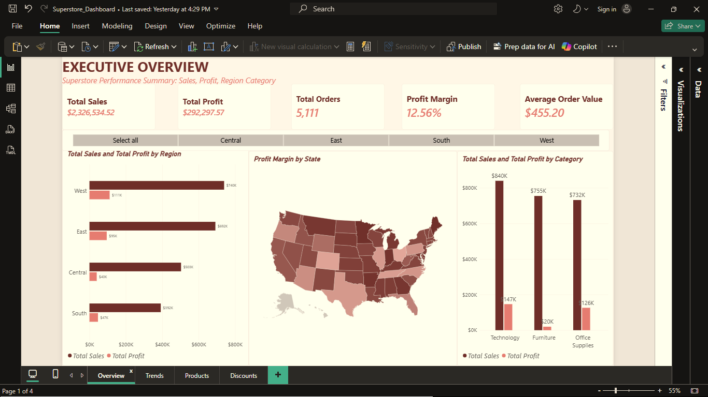
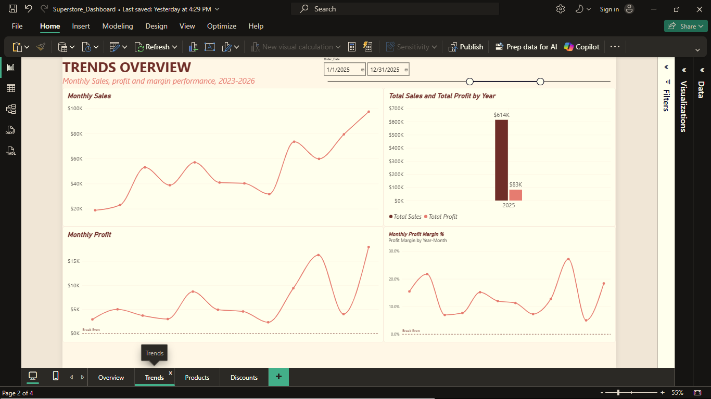
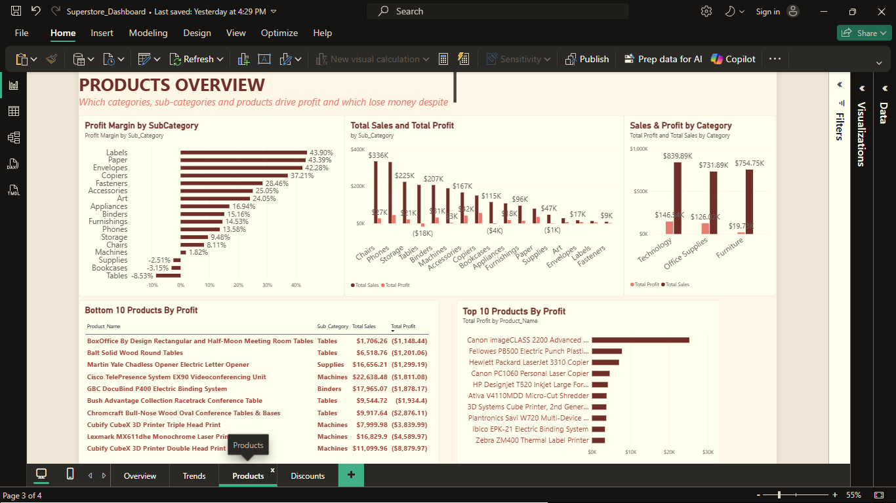
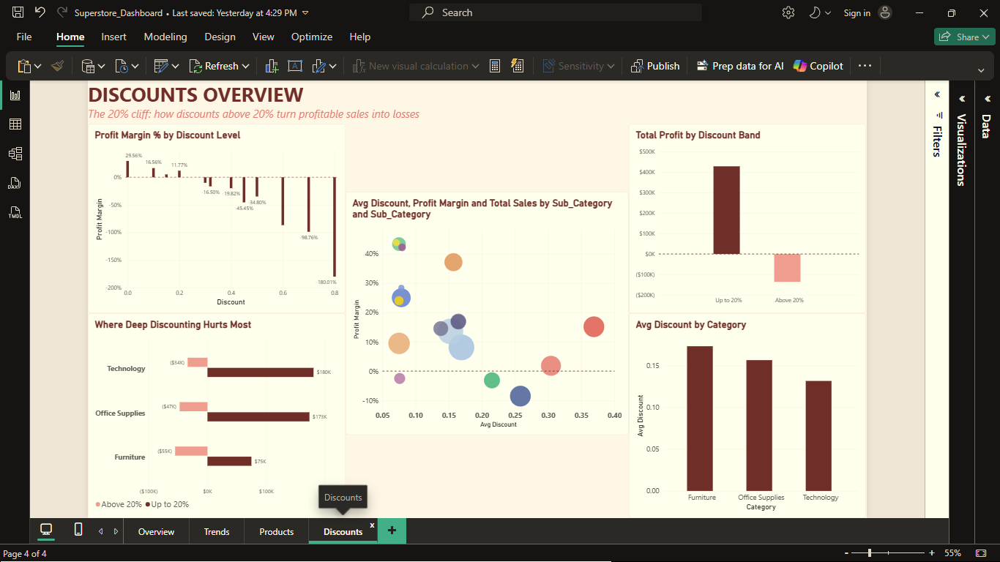

# superstore-sales-analysis
# Superstore Sales & Profitability Analysis

## Project Overview

This project analyzes Superstore sales performance, profitability, regional trends, product categories, and the impact of discounting using **MySQL and Microsoft Power BI**.

The objective is to transform raw sales data into actionable business insights that can help management understand revenue performance, identify profitability challenges, and make more informed decisions.

## Business Questions

This analysis explores the following questions:

- How are sales and profits performing overall?
- How do sales and profitability vary over time?
- Which product categories contribute most to sales and profit?
- How does performance differ across regions and states?
- What is the relationship between discount levels and profit margins?
- Are higher discounts associated with reduced profitability or losses?

## Tools & Technologies

- **MySQL:** Data exploration, querying, aggregation, and analysis.
- **Microsoft Power BI:** Data visualization, KPI reporting, and interactive dashboard development.
- **SQL:** Filtering, grouping, aggregations, and analytical queries.

## Dashboard Pages

### 1. Executive Overview
Provides a high-level summary of business performance through key performance indicators, regional comparisons, state-level profit margins, and category-level sales and profit analysis.

### 2. Trends
Examines sales and profitability patterns over time to help identify changes in business performance.

### 3. Products
Explores product and category performance to identify differences in sales and profitability.

### 4. Discounts
Investigates the relationship between discount levels and profitability, comparing profit margins, discount bands, categories, and sub-categories.

## Key Areas of Analysis

- Overall sales and profit performance.
- Regional and state-level comparisons.
- Product category performance.
- Trends in sales and profitability.
- Discount levels and their relationship with profit margins.

## Repository Contents

- `superstore_sales_analysis.sql` — consolidated SQL analysis script.
- `Superstore_Dashboard.pbix` — interactive Power BI report.

## Skills Demonstrated

- SQL querying and data analysis.
- Business performance measurement.
- KPI development and reporting.
- Data visualization and dashboard design.
- Profitability and discount analysis.
- Translating business questions into analytical insights.

## Conclusion

This project demonstrates an end-to-end analytics workflow, from investigating sales data using SQL to presenting findings through a multi-page Power BI report.

The analysis is designed to support data-driven decision-making by making sales performance, profitability patterns, and potential areas of concern easier to identify.

---

**Tools:** MySQL | Microsoft Power BI
